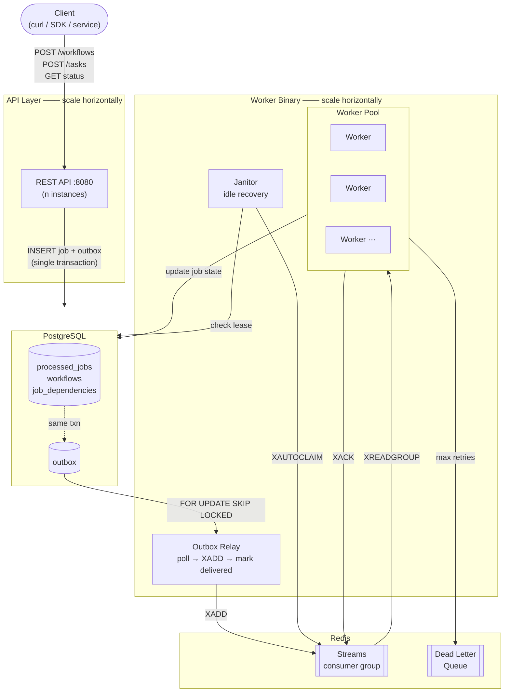
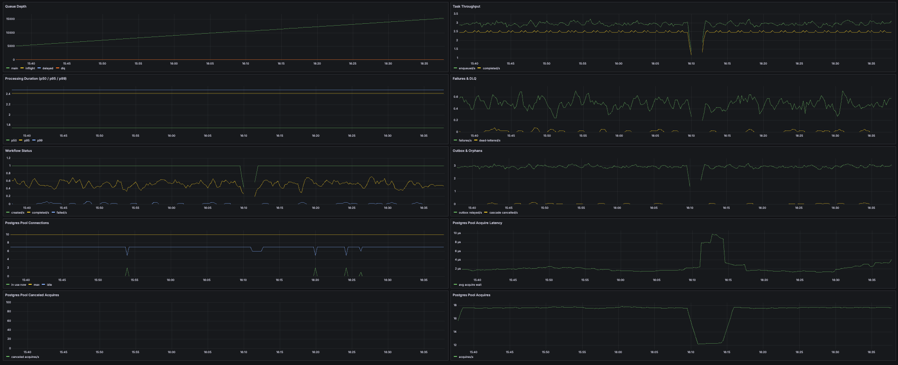

# GoQueue — Distributed Task Queue

A distributed task queue built in Go. Tasks declare parent dependencies and only run once all parents complete. Failures cascade — if a parent fails, all downstream tasks are automatically cancelled. Built on Redis Streams for delivery and PostgreSQL for durable execution state.

This isn't a wrapper around an existing queue library. It's a ground-up implementation to understand the hard parts: what breaks when a worker crashes mid-execution, how to guarantee at-least-once delivery with fenced idempotent state transitions, and how DAG execution actually works at the storage layer.

---

## What it does

You submit a workflow — a set of tasks with dependency edges. GoQueue handles execution order, retries, failure propagation, and recovery. You don't manage any of that.

```
VIDEO_UPLOAD ──► VIDEO_TRANSCODE ──► VIDEO_NOTIFY
```

`VIDEO_TRANSCODE` won't start until `VIDEO_UPLOAD` completes. If `VIDEO_UPLOAD` fails after 3 retries, `VIDEO_TRANSCODE` and `VIDEO_NOTIFY` are automatically cancelled. No polling, no manual state checks.

---

## Architecture



The API and Worker are **separate binaries** that communicate only through PostgreSQL — no direct RPC between them. Both can be scaled horizontally. The API writes jobs, the Worker picks them up through Redis Streams.

---

## How it works

### 1. Submitting a workflow

When you `POST /api/v1/workflows/:id/tasks`, the API writes the job row and an outbox row in a **single PostgreSQL transaction**. Either both land or neither does. The task is not yet in Redis.

```
API → BEGIN
API → INSERT INTO processed_jobs (status = QUEUED)
API → INSERT INTO outbox (delivered = false)
API → COMMIT
```

### 2. Outbox relay delivers to Redis

A relay goroutine inside the worker binary polls the outbox table every second using `FOR UPDATE SKIP LOCKED` — safe for multiple relay replicas. It publishes each undelivered row to Redis Streams via `XADD`, then marks it delivered.

```
Relay → SELECT undelivered rows FOR UPDATE SKIP LOCKED
Relay → XADD → Redis Stream
Relay → UPDATE outbox SET delivered = true
```

If the relay crashes between `XADD` and marking delivered, it re-publishes on restart. The generation counter and delivery ID on each message make that duplicate harmless.

### 3. Worker claims and executes

Workers call `XREADGROUP` to atomically take a message from the stream into their Pending Entry List (PEL). They then claim a PostgreSQL lease — a UUID token issued at claim time. Every subsequent write (heartbeat, completion, failure) must present that token. A stale worker whose lease was revoked cannot commit.

```
Worker → XREADGROUP (message enters PEL)
Worker → UPDATE processed_jobs SET status=RUNNING, lease_token=<uuid>
Worker → ... do work ...
Worker → UPDATE processed_jobs SET status=COMPLETED WHERE lease_token=<uuid>
Worker → XACK (remove from PEL)
```

### 4. DAG fanout on completion

When a task completes, a single transaction marks it done, acquires a `pg_advisory_xact_lock` on the workflow ID, finds all children whose every parent is now `COMPLETED`, promotes them to `QUEUED`, and writes their outbox rows. The advisory lock prevents two concurrent parent completions from racing on a shared child.

### 5. Failure and recovery

**Retry:** On failure, `RecordFailure` increments the counter and schedules a new outbox delivery with exponential backoff — all in one transaction.

**DLQ:** Once `max_retries` is exhausted, the task moves to the dead letter queue and all descendants are cascade-cancelled via recursive CTE.

**Crash recovery:** The Janitor runs on an interval. It uses `XAUTOCLAIM` to find PEL entries idle longer than `HOLD_TTL`, then checks the PostgreSQL lease. Redis tells it what *might* need recovery. PostgreSQL decides what *actually* does. A live lease is never touched.

---

## Key guarantees

- **At-least-once delivery** — Transactional Outbox ensures every job reaches Redis even across crashes
- **Fenced, idempotent execution** — UUID lease token on every claim; completions, failures, and heartbeats all validate the token, making stale worker commits structurally impossible
- **Atomic DAG fanout** — parent completion and child enqueue in a single transaction with advisory lock
- **Cycle-safe cancellation** — recursive CTE with path tracking cancels all descendants
- **Workers block on `XREADGROUP`** — no polling in the hot path; the relay polls the outbox on a 1s interval to move jobs into Redis
- **Crash recovery** — Janitor reclaims idle PEL entries; PostgreSQL lease is the authority
- **Handler idempotency is the caller's responsibility** — the lease prevents duplicate concurrent execution, but if a handler has already sent an email or called an external API before crashing, the fence cannot undo it. Handlers must be idempotent.

---

## Repository-layer performance

Measured on Apple M3 Pro (11-core), 18GB RAM, local Docker PostgreSQL 14, `synchronous_commit = on`, pgx pool of 20 connections.

| Operation | Throughput | Latency |
|---|---|---|
| `CreateJob` — serial, full transactional outbox | ~2,000/sec | — |
| `CreateJob` — parallel (20 connections) | ~6,500/sec | — |
| `TryStartJob` (fenced claim) — serial | ~2,500/sec | — |
| `TryStartJob` (fenced claim) — parallel | ~7,500/sec | — |
| `MarkAsCancelledCascading` — 11-task chain | ~2,800/sec | — |
| End-to-end `CreateWorkflow + CreateJob` | — | p50: 0.66ms · p95: 0.88ms · p99 < 2ms |

**Single-node ceiling:** parallelism gives ~3x over serial. The bottleneck is likely commit/WAL-bound on one Postgres node — not the application layer. Horizontal scaling requires partitioning workflows across multiple Postgres nodes.

Reproduce with:
```bash
# throughput benchmarks
go test ./pkg/repository/ -run '^$' -bench=. -benchtime=20000x -count=1

# latency test (5000 samples, 20 warmup)
go test ./pkg/repository/ -run TestEndToEndLatency -v -count=1
```

Benchmarks are in [`pkg/repository/bench_test.go`](pkg/repository/bench_test.go).

---

## Quick Start

```bash
# start postgres and redis
docker-compose up -d postgres redis

# terminal 1 — worker
go run ./cmd/worker/

# terminal 2 — api
go run ./cmd/api/
```

Create a workflow:
```bash
curl -X POST http://localhost:8080/api/v1/workflows \
  -H "Content-Type: application/json" \
  -d '{"name": "echo-demo"}'
```

Add a task:
```bash
curl -X POST http://localhost:8080/api/v1/workflows/<workflow-id>/tasks \
  -H "Content-Type: application/json" \
  -d '{
    "task_type": "reference.echo",
    "payload": {"message": "hello"}
  }'
```

Check status:
```bash
curl http://localhost:8080/api/v1/workflows/<workflow-id>
curl http://localhost:8080/api/v1/tasks/<task-id>
```

---

## Development checks

Install [golangci-lint v2.15.0](https://golangci-lint.run/docs/welcome/install/local/), then run:

```bash
make lint
```

This checks all Go packages and tests with the standard linters (including error
handling, `go vet`, static analysis, and unused code) and `gofmt` formatting.
The same checks run on pull requests and pushes to `main` in GitHub Actions.
Use `golangci-lint fmt` to apply formatting fixes.

Protobuf checks remain available through `make proto-check`.

---

## API

| Method | Endpoint | Description |
|--------|----------|-------------|
| `POST` | `/api/v1/workflows` | Create a workflow |
| `GET` | `/api/v1/workflows/:id` | Get workflow status |
| `POST` | `/api/v1/workflows/:id/tasks` | Add a task to a workflow |
| `GET` | `/api/v1/tasks/:id` | Get task status |

Task requests accept only `parent_ids`, `task_type`, and `payload`. Omit `parent_ids` for a root task, or pass an array of parent task UUIDs. The current catalog supports `reference.echo` with a payload such as `{"message":"hello"}`.

The server chooses queue routing and retry settings. Unknown request fields, including `queue_name`, `max_retries`, TTL, and tenant overrides, return `400 Bad Request`. Send exactly one JSON object per request.

---

## Observability

Prometheus at `http://localhost:9091`, Grafana at `http://localhost:3000` (`admin` / `admin`).

28 metrics across queue depth, throughput, DAG fanout, error rates, and PostgreSQL pool state (acquire rate, wait latency, idle/active connections).



---

## Configuration

All configuration via environment variables. Key ones:

| Variable | Default | Description |
|----------|---------|-------------|
| `POSTGRES_CONN_STRING` | — | PostgreSQL connection string |
| `REDIS_ADDRESS` | `localhost:6379` | Redis address |
| `QUEUE_NAME` | `queue:video_processing` | Default queue name |
| `WORKER_COUNT` | `5` | Number of concurrent workers |
| `MAX_RETRIES` | `3` | Max retries before DLQ |
| `HOLD_TTL` | `20s` | Lease TTL per task attempt |
| `SERVER_ADDRESS` | `:8080` | API server address |

Full reference in [docs/configuration.md](docs/configuration.md).

---

## Project Structure

```
.
├── cmd/
│   ├── api/          # REST API binary
│   └── worker/       # Worker binary (execution, janitor, outbox relay)
├── internal/
│   └── api/          # Handlers, services, models (API-private)
├── pkg/
│   ├── circuitbreaker/
│   ├── config/
│   ├── redis/
│   └── repository/   # PostgreSQL queries
├── db/
│   ├── schema.sql
│   └── migrations/
├── deploy/
│   ├── prometheus/
│   └── grafana/
└── docs/
```

---

## Design decisions

Every non-obvious decision has a writeup in [docs/Tradeoff.md](docs/Tradeoff.md) — what the naive approach breaks, what was chosen instead, and what it costs.

The implementation contract for the planned Go worker SDK is in [docs/WORKER_SDK_DESIGN.md](docs/WORKER_SDK_DESIGN.md). It defines the worker protocol, ownership boundaries, idempotency rules, and the required conformance suite before SDK code is added.

Sprint 1 adds scoped API-key authentication and idempotent REST writes; worker-to-Gateway authentication remains mTLS. The implementation contract is in [docs/REST_API_AUTH_DESIGN.md](docs/REST_API_AUTH_DESIGN.md).

The gated delivery sequence and expected result for each team sprint are in [docs/PLATFORM_SPRINT_PLAN.md](docs/PLATFORM_SPRINT_PLAN.md).

Two mechanisms worth calling out explicitly:

**Circuit Breaker** ([`pkg/circuitbreaker/`](pkg/circuitbreaker/)) — a 3-state FSM (closed/open/half-open) wraps every PostgreSQL call in the worker. When the DB goes down, the breaker opens immediately and rejects claims without hitting the pool, preventing goroutine pile-up. It probes on a configurable reset timeout and closes automatically on success.

**Dual heartbeat** — while a task is running, two independent heartbeats fire on an interval: a PostgreSQL lease renewal (which extends `lease_expires_at`) and a Redis `XCLAIM` touch (which resets the PEL idle timer). PostgreSQL is the authority — a Redis heartbeat failure is a warning, not a cancellation. A DB lease loss cancels the handler context immediately.

---

## Tech Stack

Go 1.25 · PostgreSQL 14 · Redis 7 Streams · Prometheus · Grafana · Docker
