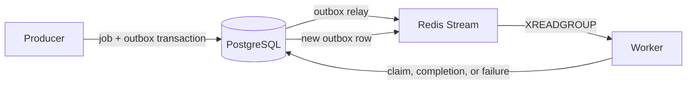

# Architecture

## Delivery path

PostgreSQL is the durable authority for job state, dependencies, the outbox, and execution leases. Redis Streams distributes immutable delivery records; it is not the source of truth for whether a job may run.

## Redis Streams

For `QUEUE_NAME=queue:video_processing`, the application uses:

| Key | Purpose |
| --- | --- |
| `queue:video_processing:stream` | task deliveries written with `XADD` |
| `queue:video_processing:workers` | consumer group for workers |
| `queue:video_processing:dlq` | terminal delivery records |

A worker receives a delivery with `XREADGROUP`. It calls PostgreSQL to acquire the job lease, processes only after a successful claim, and calls `XACK` after the resulting durable state is committed. A duplicate or stale delivery is acknowledged without running the task.

## Outbox and retries

Creating a root job, promoting a ready child, and scheduling a retry all write an outbox row in the same PostgreSQL transaction as the job-state change. The relay publishes pending rows to the stream and marks them delivered afterwards.

A relay crash can publish a delivery more than once. Each delivery carries an ID and generation, and PostgreSQL accepts only the current generation, so physical duplicates are safe.

## Leases and recovery

Workers renew their PostgreSQL lease and reset the Redis pending-entry idle time while processing. The janitor uses `XAUTOCLAIM` to inspect idle pending entries and checks the database lease before acknowledging or scheduling a replacement delivery. A Redis heartbeat never authorizes a stale worker to finish a job.

## DAG execution

Jobs with unmet dependencies remain `PENDING`. Completion is serialized per workflow, so when the final parent completes, all newly-ready children are promoted to `QUEUED` and receive outbox entries atomically. A terminal failure marks descendants `CANCELLED` with a cycle-safe recursive PostgreSQL query.

## Observability

`/metrics` exposes queue counters, stream depth and pending depth, and pgx pool metrics. The Grafana dashboard shows throughput, workflow state, failures, and PostgreSQL pool utilization.
