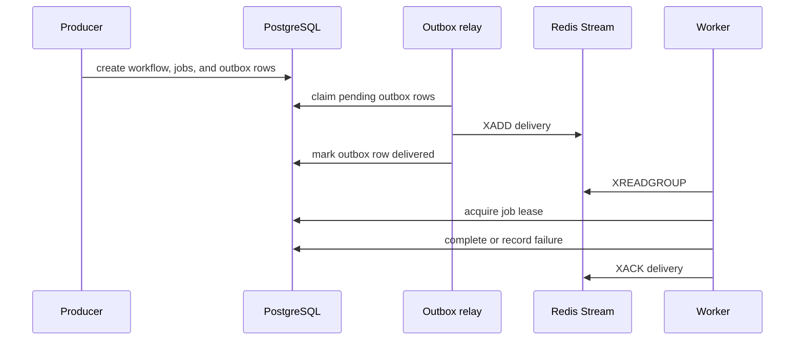
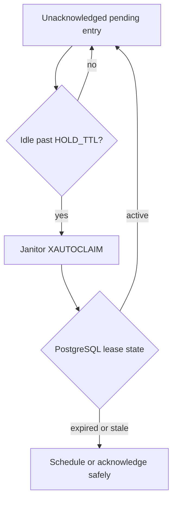

# System Flows

## Publish and consume



Workers never publish tasks directly. Completion, retry scheduling, and child promotion each create a durable outbox row; the relay delivers it to Redis Streams.

## Successful DAG progression

1. A root job is created as `QUEUED` with an outbox row. Dependent jobs start as `PENDING`.
2. The relay appends the root delivery with `XADD`.
3. A worker reads it with `XREADGROUP` and must acquire its PostgreSQL lease.
4. On success, the job is marked `COMPLETED`. Any child whose parents are all completed is promoted to `QUEUED` and gets an outbox row in the same transaction.
5. The worker acknowledges the original stream entry with `XACK`.

## Failure and cancellation

1. A worker records the failure while holding its lease.
2. A retryable failure creates the next outbox generation; the old stream entry is acknowledged as stale.
3. A terminal failure is written to the DLQ stream and all descendants are marked `CANCELLED`.
4. The workflow status is recalculated from durable job states.

## Crash recovery



The pending-entry list is only a recovery signal. PostgreSQL lease and generation checks decide whether a delivery is still valid.

## Debugging commands

```bash
# Stream length and consumer-group pending count
redis-cli XLEN queue:video_processing:stream
redis-cli XPENDING queue:video_processing:stream queue:video_processing:workers

# Inspect recent deliveries and consumer group state
redis-cli XREVRANGE queue:video_processing:stream + - COUNT 10
redis-cli XINFO GROUPS queue:video_processing:stream
```
